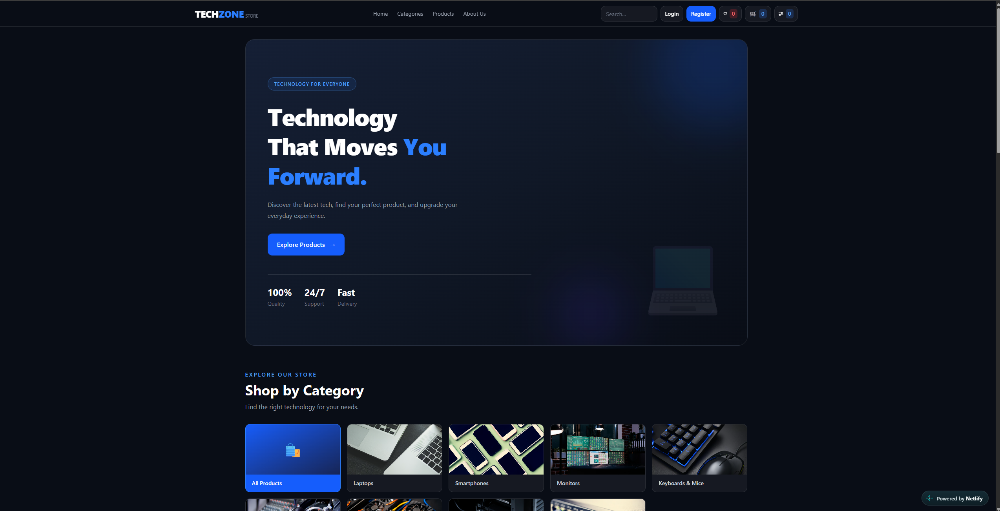
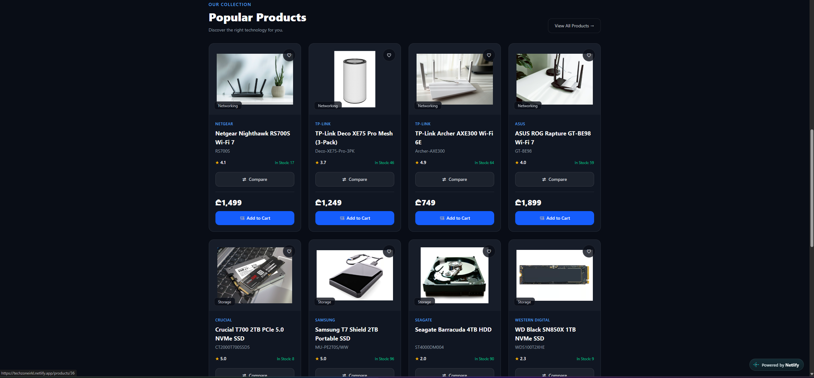
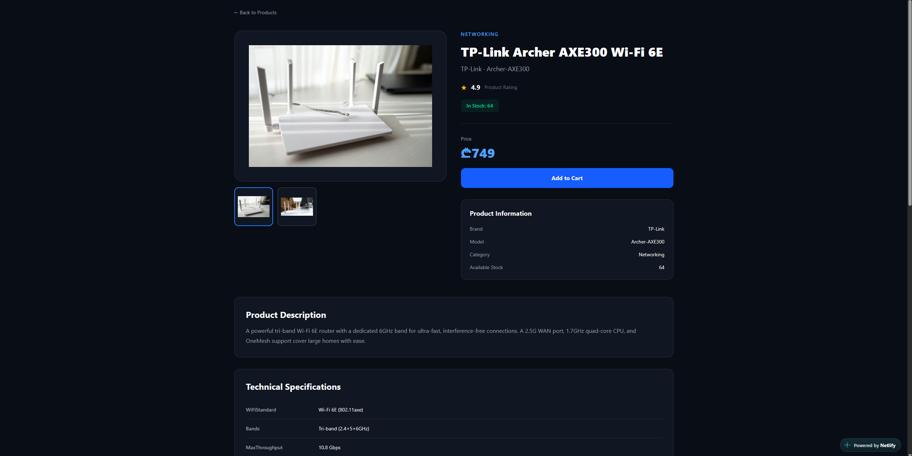
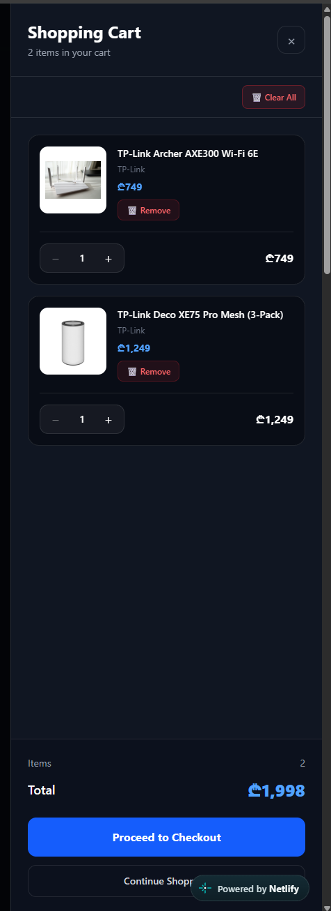

# TECHZONE — Modern Tech E-Commerce Platform

A modern, responsive e-commerce web application built with React, TypeScript, and Tailwind CSS.

TECHZONE delivers a seamless shopping experience with product browsing, advanced filtering, authentication, shopping cart management, wishlists, and product comparison.

## Live Demo

**[Visit TECHZONE](https://techzoneirkl.netlify.app/)**

**[GitHub Repository](https://github.com/iraklibibilashv/TECHZONE)**

---

## Screenshots

### Homepage


### Product Collection


### Product Details


### Wishlist


---

## Tech Stack

| Technology | Purpose |
|------------|---------|
| React | Frontend UI |
| TypeScript | Type Safety |
| Vite | Build Tool |
| Tailwind CSS | Styling |
| React Router | Client-Side Routing |
| TanStack React Query | Server State Management |
| REST API | Backend Integration |
| JWT | Authentication |
| Netlify | Deployment |
| Git & GitHub | Version Control |

---

## Features

### Product Management
- Dynamic product listing from REST API
- Product search and category filtering
- Product details with image galleries
- Technical specifications
- Product ratings and reviews
- Stock availability
- Product comparison

### Shopping Cart
- Add products to cart
- Remove products from cart
- Update product quantities
- Calculate cart totals
- Persistent cart data through backend API

### Wishlist
- Add products to favorites
- Remove individual favorites
- Clear wishlist
- Add wishlist products directly to cart

### Authentication
- User registration and login
- Email verification
- JWT-based authentication
- User profile management
- Password recovery and reset
- Protected routes
- Automatic logout on unauthorized requests

### Admin Dashboard
- Separate admin authentication
- Protected admin routes
- Product management interface
- Category management interface
- Inventory management interface

> Note: Admin functionality requires authorized backend access and has not been fully tested with an administrator account.

---

## Performance & Optimization

- React Query caching
- Lazy-loaded routes
- React memoization
- Optimized production build
- Centralized API error handling
- Error Boundary
- Custom 404 page
- Responsive layout

### Lighthouse Results

| Category | Score |
|----------|-------|
| Performance | 99 |
| Accessibility | 100 |
| Best Practices | 100 |
| SEO | 100 |

---

## Installation

### 1. Clone the Repository

```bash
git clone https://github.com/iraklibibilashv/TECHZONE.git
cd TECHZONE
```

### 2. Install Dependencies

```bash
npm install
```

### 3. Configure Environment Variables

Create a `.env` file in the project root:

```env
VITE_API_URL=YOUR_API_BASE_URL
VITE_API_KEY=YOUR_API_KEY
```

### 4. Start Development Server

```bash
npm run dev
```

### 5. Build for Production

```bash
npm run build
```

---

## Project Structure

```text
TECHZONE/
├── public/
├── screenshots/
│   ├── homepage.png
│   ├── products.png
│   ├── product-details.png
│   └── wishlist.png
├── src/
│   ├── components/
│   ├── pages/
│   │   └── admin/
│   ├── services/
│   ├── types/
│   ├── lib/
│   ├── App.tsx
│   └── main.tsx
├── package.json
└── README.md
```

---

## Security

- JWT-based authentication
- Protected user and admin routes
- Token expiration checks
- Unauthorized request handling
- Centralized API error management

**Important:** Backend authorization is required to enforce access control. Frontend route protection alone does not provide security.

Environment variables prefixed with `VITE_` are exposed in the client-side bundle and must not contain confidential secrets.

---

## Deployment

The application is deployed on Netlify with GitHub integration.

**Live Website:** https://techzoneirkl.netlify.app/

---

## Project Status

The frontend is deployed and core shopping features have been tested in production.

Administrator functionality requires further verification with authorized backend credentials.

---

## Author

**Irakli Bibilashvili**

GitHub: https://github.com/iraklibibilashv

---

Built with React, TypeScript, and Tailwind CSS.
